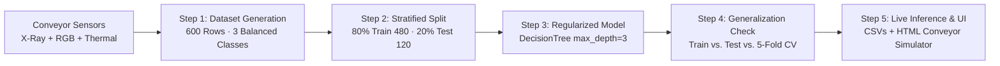

# AI-Integrated Robotic E-Waste & Battery Sorting Simulator

[](https://vinaya-2003.github.io/ai-ewaste-robot-sorter/)
[](ai-ewaste-robot-sorter.ipynb)
[](ai-ewaste-robot-sorter.ipynb)

An end-to-end Machine Learning pipeline and real-time browser conveyor simulator that fuses multi-sensor readings (**X-Ray Density**, **RGB Metallic Ratio**, and **Thermal Signature**) to detect hidden lithium-ion batteries in mixed electronic waste and route items to safe robotic actuators.

👉 **[Launch the Live Interactive Conveyor Simulator](https://vinaya-2003.github.io/ai-ewaste-robot-sorter/)**

---

## 1. Operational & Safety Problem

Hidden lithium-ion batteries sealed inside discarded smartphones, wireless earbuds, and toys cause thousands of recycling facility fires every year when crushed by standard mechanical shredders, while locking away high-value critical minerals such as lithium, cobalt, and copper.

This project solves that sorting bottleneck through two integrated components:
1. **Multi-Sensor Fusion & Risk Classification (`ai-ewaste-robot-sorter.ipynb`):** Trains a regularized `DecisionTreeClassifier` on 600 synthetic multi-sensor records to separate hazardous battery devices, precious-metal circuit boards, and inert plastic casings without requiring heavy GPU vision models.
2. **Real-Time Robotic Actuator Simulator (`index.html`):** Translates the trained Decision Tree's learned `IF-ELSE` safety rules into an interactive conveyor belt UI that triggers deterministic sorting commands (`PICK`, `DIVERT`, or `PASS`) in milliseconds.

---

## 2. System Architecture & 5-Step Workflow



---

## 3. Complete Tech Stack & Engineering Rationale

| Layer | Technologies & Parameters | Architectural Rationale |
| :--- | :--- | :--- |
| **Data Engineering** | `Python 3`, `NumPy`, `Pandas` | Synthesizes **600 sensor records** (`200` samples per class across 3 continuous features) with Gaussian sensor noise ($\sigma = 0.03$) to prevent artificially trivial decision boundaries. |
| **Validation Strategy** | `train_test_split` (`80/20`, `stratify=y`), `5-Fold Cross-Validation` | Guarantees identical class proportions across training (`480` rows) and unseen testing (`120` rows) while verifying model stability across 5 folds. |
| **Machine Learning Model** | `Scikit-Learn` `DecisionTreeClassifier` (`max_depth=3`, `min_samples_leaf=10`) | Requires zero feature scaling, executes in microseconds on edge controllers, and exports human-auditable `IF-ELSE` safety thresholds via `export_text()`. |
| **Overfitting & Underfitting Control** | Depth cap (`max_depth=3`) + leaf floor (`min_samples_leaf=10`) | Prevents the tree from memorizing single-point sensor outliers while retaining up to $2^3 = 8$ decision regions—sufficient to cleanly separate all 3 classes. |
| **Why Tabular ML over CNN** | 1D Physical Sensor Vector (`[xray_density, metallic_ratio, thermal_signature]`) | Convolutional Neural Networks (CNNs) are built for 2D pixel grids; fusing extracted physical sensor metrics via a regularized tree delivers high accuracy on CPU without thousands of labeled X-ray images. |
| **Interactive Frontend** | Vanilla `HTML5`, `CSS3`, `JavaScript (ES6+)` | Zero-dependency, lightweight web application deployed via **GitHub Pages** that mirrors the exact Decision Tree thresholds in real time. |

---

## 4. Interactive Web Simulator Features (`index.html`)

Visit **[vinaya-2003.github.io/ai-ewaste-robot-sorter](https://vinaya-2003.github.io/ai-ewaste-robot-sorter/)** to test the robotic routing logic directly in your browser:
* **Animated X-Ray / RGB Conveyor Belt:** Visualizes items passing through the overhead scanner beam and diverting into color-coded discharge, precious-metal recovery, or polymer shredder lanes.
* **Live Sensor Sliders:** Adjust **X-Ray Density**, **RGB Metallic Ratio**, and **Thermal Signature** (`0.00` – `1.00`) to probe boundary edge cases and see the active `IF-ELSE` rule update dynamically.
* **One-Click Device Presets:** Test realistic conveyor items (`+ Smartphone`, `+ Router PCB`, `+ Plastic Shell`) and inspect the live actuator decision log table.

---

## 5. Repository Structure

```text
ai-ewaste-robot-sorter/
├── README.md                        # Project documentation, architecture, and setup guide
├── index.html                       # Interactive browser conveyor belt & robotic actuator simulator
├── ai-ewaste-robot-sorter.ipynb     # 5-step Colab/Jupyter ML pipeline & generalization evaluation
├── ewaste_sensor_dataset.csv        # Generated 600-row balanced multi-sensor training/test dataset
└── live_conveyor_predictions.csv    # Unseen conveyor inference log with robotic actuator commands
```

---

## 6. Quickstart & Local Execution

1. **Clone the Repository:**
   ```bash
   git clone https://github.com/Vinaya-2003/ai-ewaste-robot-sorter.git
   cd ai-ewaste-robot-sorter
   ```

2. **Run the Machine Learning Notebook:**
   Open `ai-ewaste-robot-sorter.ipynb` in **Google Colab** or **VS Code** (with `numpy`, `pandas`, and `scikit-learn` installed) and run all cells to train the classifier, inspect the `IF-ELSE` safety rules, and regenerate both CSV deliverables.

3. **Launch the Conveyor Simulator Locally:**
   Open `index.html` in any modern web browser (or via VS Code **Live Server**) — no backend server or package installation required.